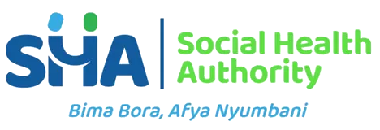

<p align="center">
  
</p>

<h1 align="center">SHA Daraja 360</h1>

<p align="center">
  <strong>Bima Bora, Afya Nyumbani</strong><br>
  Social Health Authority — claims workflow validation
</p>

<p align="center">
  
  
  
</p>

---

**SHA Daraja 360** is the Social Health Authority’s portal for **stage 9 of DHA certification**: SHA claims workflow validation.

Vendors evidence SHA claims journeys. SHA validators review the evidence. The signed result goes back to the DHA Certification Portal.

## Repositories

| Repository | Role |
|---|---|
| [sha-frontend](https://github.com/SHA-Daraja-360/sha-frontend) | Web portal — vendors, SHA staff, DHA read-only |
| [sha-validation-service](https://github.com/SHA-Daraja-360/sha-validation-service) | Cases, checklists, evidence, scheduling, findings, VidVal, Results API |
| [sha-auth-service](https://github.com/SHA-Daraja-360/sha-auth-service) | SHA staff accounts, vendor accounts, sign-on tickets |
| [sha-api-gateway](https://github.com/SHA-Daraja-360/sha-api-gateway) | Single HTTP entry — routes, rate limits, TLS |

All four are **private**. Ask an org admin if you need access.

## How it fits

```
DHA Certification Portal  →  SHA Daraja 360  →  Results API  →  DHA
        vendor SSO              evidence + review         signed outcome
```

## People

| GitHub | Role |
|---|---|
| [@icp-smartprojects](https://github.com/icp-smartprojects) | Admin |
| [@Malik186](https://github.com/Malik186) | Admin |
| [@Raccoon254](https://github.com/Raccoon254) | Admin |

---

<p align="center">
  <br>
  <sub>Social Health Authority · Kenya</sub>
</p>
